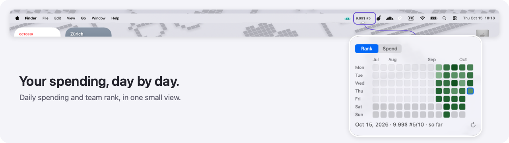

# PortkeyBar

A tiny macOS menu-bar widget for [Portkey](https://portkey.ai) users who want their spending and team rank at a glance.


[](LICENSE)


## ✨ Features

- Your spending and workspace rank, always in the menu bar.
- Pick a time range or peek at daily ranking history.
- Native Mac widget; your API key stays in macOS Keychain.

## 📦 Installation

Requires **macOS 14+**, an **Apple Silicon or Intel Mac**, and **Swift 6 Command Line Tools**. Install missing tools with `xcode-select --install`.

```sh
git clone https://github.com/Reeezer/portkeybar.git ~/portkeybar
cd ~/portkeybar
bash build.sh
mkdir -p ~/Applications
ditto .build/PortkeyBar.app ~/Applications/PortkeyBar.app
open ~/Applications/PortkeyBar.app
```

To update, quit PortkeyBar, run `git pull --ff-only` in the source folder, and repeat the build, copy, and open steps.

## 🚀 Usage

1. **Connect:** click the widget → **Settings…**, paste your **User ID** and **API key**, then **Save**.
2. **Read:** `6.09$ #3` = $6.09 spent, third-highest in your workspace. Ties share a rank.
3. **Choose a period:** open **Time range**. The default is **Last 24 hours**.
4. **Look back:** open **Ranking history…** and hover a day for its spend and rank.
5. **Refresh:** choose **Refresh now**. It also updates every five minutes and after wake.



> [!NOTE]
> A ⚠ means the last refresh failed; open the menu for the error.

## ⚙️ Configuration

Set these in **Settings…** or directly in the widget's menu:

| Option | Default | Description |
| --- | --- | --- |
| User ID | Mac username | Exact identifier from Portkey's user analytics. |
| API key | None | Workspace key with analytics access; saved in Keychain. |
| Time range | Last 24 hours | Choose a rolling or calendar range; your choice is saved. |
| Launch at login | On | Toggle it in the menu. |

Connects to Portkey Cloud (`api.portkey.ai`); custom endpoints aren't supported.
